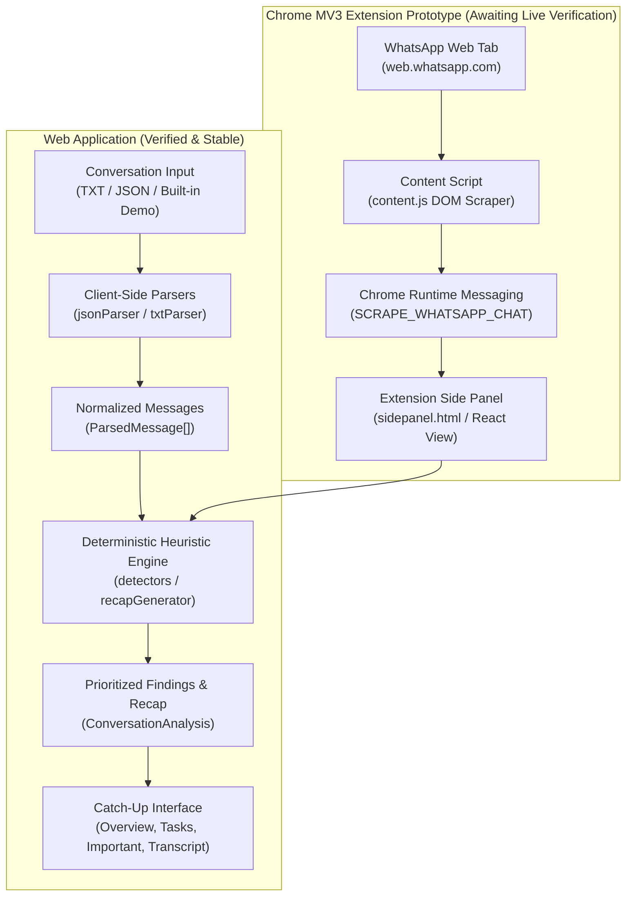

# What Did I Miss? (Missed.)

> **Catch up on unread group chats and incident channels in seconds — 100% on-device, deterministic, and instant.**

[](#privacy--security-boundary)
[](#architecture)
[](#honest-analysis-disclosure)
[](#tech-stack)
[-brightgreen)](#testing--verification)
[](#chrome-extension-installation-manifest-v3)

---

## The Problem: The Unread Backlog

When software engineers, team leads, on-call responders, and managers step away for focused sprints, cross-team meetings, or time off, they routinely return to hundreds of unread messages across incident channels, project threads, and group chats.

Reading through conversational noise sequentially is slow, exhausting, and error-prone. Critical architectural decisions, P0 production blockers, assigned action items, and tight deadlines get buried beneath status banter and emoji reactions.

### Intended Users
- **Engineers & On-Call Responders:** Quickly triage incident war-rooms, post-incident cutovers, and deployment updates.
- **Engineering Managers & Tech Leads:** Extract decisions, commitments, and task ownership without reading every thread.
- **Cross-Functional Teammates:** Filter conversations specifically for their own mentions and assigned action items.

### The Solution: Missed.
**What Did I Miss?** (branded as **Missed.**) analyzes chat exports or active web conversation views entirely inside the browser. Using transparent, deterministic pattern matching, it triages conversational history into an actionable executive recap, prioritized alerts, decisions, interactive task checklists, and deadline trackers—linking every single finding directly back to its exact source message in the timeline.

---

## Feature Highlights

- **Compact Catch-Up Interface:** Engineered for a 380px extension side-panel width with responsive desktop split-screen capability for full-browser reviews.
- **Instant Built-In Incident Demo:** Boots immediately with the *"Payment Gateway Migration Cutover"* scenario (14 realistic messages across 4 teammates), enabling instant evaluation without requiring uploaded files.
- **Multi-Format Export Ingestion:** Drag-and-drop or file-picker upload for `.txt` and `.json` chat exports (WhatsApp, Slack, bracketed timestamps, and generic transcripts) up to 10MB.
- **Deterministic Heuristic Extraction:**
  - **Executive Recap:** Message count, active contributors, conversation duration, and dominant topical keywords.
  - **Urgent & Blocker Alerts:** Surfaces critical blockers, rollback triggers, latency spikes, and P0 incident markers.
  - **Key Decisions:** Detects architectural sign-offs, consensus statements, and confirmed choices.
  - **Action Items & Task Checklist:** Identifies assigned tasks and commitments with interactive completion checkboxes.
  - **Deadlines & Time Targets:** Flags temporal commitments (EOD, specific hours, dates).
  - **Mentions & Direct Inquiries:** Isolates `@username` callouts and open questions.
- **Urgency & Relevance Priority Scoring:** Automatically triages findings into `High` (P0/blockers), `Medium` (tasks/decisions), and `Low` (mentions/notes) priority tiers.
- **Source-Message Deep Linking:** Every finding card links directly to its source message. Clicking a finding scrolls the timeline to the message and pulses a highlight ring (or opens the inspection drawer in side-panel mode).
- **Search & Participant Filtering:** Search across finding snippets, titles, senders, and assignees, or filter by specific participants.
- **Summary Export:** One-click "Copy Summary" generates a formatted Markdown digest containing recap bullets, decisions, and GitHub-flavored markdown task checklists (`[ ]` / `[x]`).
- **100% Client-Side Architecture:** Zero backend servers, zero telemetry scripts, and zero cloud LLM API calls. Your conversations never leave your device.

---

## Honest Analysis Disclosure

> [!NOTE]
> **Deterministic Rule-Based Heuristics (Not Generative AI):**  
> This application uses transparent, deterministic regular expressions, keyword tokenization, and pattern matching running locally in JavaScript. It **does not** claim to use generative artificial intelligence, neural networks, or cloud-based LLM inference. All insights are generated deterministically and linked directly to verifiable source messages in the transcript.

---

## Architecture

The system operates as a zero-backend, client-side application with two consumption modes: the standalone web application and the Manifest V3 Chrome extension prototype.



### Architectural Boundaries
1. **Web Application Pipeline (Fully Implemented & Verified):**  
   Files are ingested through browser `FileReader` APIs, parsed into normalized `ParsedMessage` models, processed by the heuristic analysis pipeline in memory, and rendered via modular React components.
2. **Extension Prototype Pipeline (Structural Implementation):**  
   A Manifest V3 extension package is provided in `extension/` with a service worker, side panel, and content script. The content script queries WhatsApp Web DOM selectors (`div[role="row"]`, `data-pre-plain-text`). While message passing and error states are implemented, live end-to-end extraction against an authenticated WhatsApp Web session remains an **unverified prototype** pending user testing.

---

## Tech Stack

| Layer | Technology | Details / Rationale |
| :--- | :--- | :--- |
| **Monorepo Workspaces** | npm Workspaces | Unified scripts across `packages/engine`, `frontend`, and `server` |
| **Shared Analysis Engine** | `@missed/engine` (TypeScript) | Zero-dependency deterministic parsers, regex detectors, and recap generator |
| **Frontend Framework** | React 19 + Vite 8 + Tailwind CSS v4 | Modern component architecture and fast ESM build pipeline |
| **Backend API (`server/`)** | Hono + TypeScript + Zod | Strict runtime request/response validation, rate limiting, and bearer auth middleware |
| **Database & Auth** | Supabase Auth + PostgreSQL (RLS) | Per-user tenant isolation via `auth.uid() = owner_id` Row-Level Security policies |
| **Browser Extension** | Chrome Manifest V3 (`extension/`) | Side panel integration (`sidePanel`), active tab messaging (`scripting`) |
| **Automated Testing** | Node.js Test Runner (`node:test`) | Native Node test runner with `--experimental-strip-types` (47 passing tests) |
| **Static Analysis** | Oxlint + TypeScript (`tsc --noEmit`) | Zero-warning linting and strict workspace-wide typechecking |

---

## Quick-Start Guide

### Prerequisites
- Node.js (v22.6+ or v24+ recommended for `--experimental-strip-types`)
- npm (v10 or higher)

### Setup & Development (From Repository Root)

```bash
# 1. Install all workspace dependencies
npm install

# 2. (Optional) Copy environment template for backend configuration
cp .env.example .env

# 3. Start the frontend development server (http://localhost:5173)
npm run dev:frontend

# 4. Start the backend API server (defaults to port 3001; set STORAGE_MODE=memory for offline dev)
npm run dev:server

# 5. Run all automated tests across @missed/engine, frontend, and server
npm test

# 6. Run workspace-wide linting and strict TypeScript typechecking
npm run lint
npm run typecheck

# 7. Build all workspaces and the Chrome MV3 extension bundle
npm run build
npm run build:extension
```

### Database Migration Setup (Supabase PostgreSQL)
To provision the database schema and Row-Level Security policies in a live Supabase project, execute [`server/migrations/001_initial_schema.sql`](server/migrations/001_initial_schema.sql) in the Supabase SQL Editor or via `psql`, then set `SUPABASE_URL`, `SUPABASE_ANON_KEY`, and `SUPABASE_SERVICE_ROLE_KEY` in `.env`.

---

## Chrome Extension Installation (Manifest V3)

The repository includes a ready-to-load Chrome Manifest V3 extension in the `extension/` directory.

### Installation Steps
1. Open Google Chrome and navigate to `chrome://extensions/`.
2. Turn on **Developer mode** using the toggle switch in the top right corner.
3. Click the **Load unpacked** button in the top left corner.
4. Select the `extension/` folder in this repository:
   ```text
   What-Did-I-Miss/extension/
   ```
5. Click Chrome's **Side Panel** icon (or pin and click the **Missed.** icon in your extension toolbar) to open the Missed. side panel.

### Extension Verification Status & Troubleshooting
> [!IMPORTANT]
> **Prototype Status Notice:**  
> The extension manifest, background service worker, side panel, and content script are structurally implemented. However, because WhatsApp Web's DOM classes and markup are minified and subject to unannounced changes by Meta, live in-browser extraction against an active WhatsApp Web tab is currently labeled as an **extension prototype awaiting live end-to-end verification**.

The content script handles the following states gracefully:
- **Logged-Out State (`NOT_LOGGED_IN`):** Detected if WhatsApp Web displays a QR login screen. The extension prompts the user to log in before catching up.
- **No Active Conversation (`NO_ACTIVE_CHAT`):** Detected if no chat thread is open. The extension prompts the user to select a chat.
- **Empty Message Viewport (`NO_MESSAGES`):** Detected if no message rows are rendered in the DOM.
- **Fallback Demonstration:** At any time, you can click **"Load Demo"** in the extension header to explore the catch-up experience using the built-in incident dataset.

---

## Supported Import Formats

The application accepts both `.json` and `.txt` files up to 10MB in size:

### 1. JSON Exports
- **Standard Array:** Array of objects with `sender`, `text`, and optional `timestamp` / `id`.
  ```json
  [
    {
      "sender": "Maya",
      "text": "CRITICAL: Payment gateway migration failed. Latency spiked to 2.4s.",
      "timestamp": "2026-10-09T09:15:00Z"
    },
    {
      "sender": "Devon",
      "text": "Action item: @Elena please initiate the rollback runbook immediately.",
      "timestamp": "2026-10-09T09:16:30Z"
    }
  ]
  ```
- **Envelope Object:** Top-level object containing a `messages`, `conversation`, or `data` array.
  ```json
  {
    "channel": "incident-war-room",
    "messages": [
      { "sender": "Liam", "text": "Decision: Rollback approved by consensus." }
    ]
  }
  ```
- **Slack Export JSON:** Arrays with epoch timestamps (`ts`), message text (`text`), and user profiles (`user_profile.real_name`).

### 2. TXT Exports
- **Bracketed Timestamps:**
  ```text
  [2026-10-09 09:15:00] Maya: CRITICAL: Payment gateway migration failed.
  [2026-10-09 09:16:30] Devon: Action item: verify rollback by 10 AM.
  ```
- **WhatsApp Chat Exports:**
  ```text
  10/09/26, 09:15 AM - Maya: CRITICAL: Latency spike detected.
  10/09/26, 09:16 AM - Liam: Approved rollback plan.
  ```
- **Simple Colon Format:**
  ```text
  Maya: Rollback is complete.
  Devon: Please run smoke tests before EOD.
  ```
- **Multi-Line Continuations:** Lines lacking a leading timestamp or sender header are automatically appended to the preceding message body.

---

## Privacy & Security Boundary

- **100% In-Browser Execution:** File parsing, regex pattern matching, and priority scoring execute entirely inside the user's browser runtime.
- **No Remote Telemetry or Backend:** Zero network requests are dispatched to external servers, cloud databases, or third-party AI APIs.
- **Ephemeral State:** All conversation data and generated findings exist only in volatile React component state and are discarded upon page reload or tab closure.
- **Extension Permissions Rationale:**
  - `sidePanel`: Grants permission to render the catch-up companion interface in Chrome's side panel.
  - `activeTab` & `scripting`: Allows injecting the DOM scraper into the active tab upon user initiation.
  - `host_permissions: ["https://web.whatsapp.com/*"]`: Restricted strictly to WhatsApp Web. The extension cannot inspect or read any other domain or browsing history.

---

## Testing & Verification

The project includes automated test suites across all three workspaces (`packages/engine`, `frontend`, and `server`), running via the native Node.js test runner (`node:test`) with TypeScript type-stripping (`--experimental-strip-types`):

```bash
npm test
npm run test:engine
npm run test:frontend
npm run test:server
```

#### Automated Test Coverage (47 passing tests across 3 workspaces)
- **`@missed/engine` (`packages/engine/tests/` — 8 tests):** Verifies TXT/JSON parsers, missing timestamp handling, oversized file rejection, deterministic detectors, and recap synthesis.
- **`frontend` (`frontend/tests/` — 21 tests):** Verifies heuristic detectors, JSON/TXT format parsers, edge-case inputs, and source-message deep-linking fidelity.
- **`server` (`server/tests/` — 18 tests):** Verifies unauthenticated (`401`) and expired/revoked token rejection, cross-user ID tampering protection (`404`), strict Zod validation (`.strict()`), 10 MiB payload limits (`413`), malformed import handling (`422`), deterministic `@missed/engine` persistence, atomic rollback on partial save failure, user-scoped privacy settings, dependency-ordered account deletion, rate limiting (`429`), production env guardrails, and SQL migration RLS policy structure.

### Static Analysis & Build Verification
- **Linter (`npm run lint`):** `0 warnings and 0 errors` across `packages/engine`, `frontend`, and `server`.
- **Typecheck (`npm run typecheck`):** Strict `tsc --noEmit` across all workspaces.
- **Production Build (`npm run build && npm run build:extension`):** Compiles `@missed/engine`, `frontend/dist/`, `server/dist/`, and `extension/engine.js`.

---

## Known Limitations & Roadmap

### Current Limitations
1. **Deterministic Heuristics vs. Generative Nuance:** Keyword and regex matching deliver ultra-fast, privacy-preserving extraction, but cannot detect subtle conversational nuances, indirect sarcasm, or implied commitments that lack explicit trigger words.
2. **WhatsApp Web DOM Brittleness:** The extension scraper relies on standard ARIA roles (`role="row"`) and data attributes. Upstream updates to WhatsApp Web markup may require selector maintenance.
3. **Single Active Chat Scope:** Ingests and triages one conversation transcript or open chat view at a time; cross-channel aggregated prioritization is not yet supported.

### Roadmap
- [x] **Phase 1 — Shared Analysis Engine (`@missed/engine`):** Extracted unified deterministic parsers and heuristics across web, extension, and server.
- [x] **Phase 2 — Backend, Database, Auth & RLS (`server/`):** Hono REST API, Supabase Auth JWT verification, PostgreSQL schema with Row-Level Security, and atomic user-scoped persistence.
- [ ] **Phase 3–4 — Full-Stack Workspace UI & Auth Integration:** Connect the redesigned Obsidian & Solar Ember frontend workspace to the backend API.
- [ ] **Phase 5 — Opt-In AI Augmentation:** Per-conversation explicit consent for cloud AI summarization alongside deterministic heuristics.

---

## Project Structure

```text
What-Did-I-Miss/
├── docs/
│   ├── ARCHITECTURE.md          # System architecture, monorepo & RLS design
│   ├── REQUIREMENTS.md          # Product & backend security requirements
│   ├── AI_CONTEXT.md            # Project context & constraints
│   └── API.md                   # REST API & @missed/engine contracts
├── packages/
│   └── engine/                  # Shared deterministic analysis engine (@missed/engine)
│       ├── src/
│       │   ├── heuristics/      # analyzer.ts, detectors.ts, recapGenerator.ts
│       │   ├── parsers/         # index.ts, jsonParser.ts, txtParser.ts
│       │   ├── sampleConversation.ts
│       │   ├── types.ts
│       │   └── index.ts
│       └── tests/               # Shared engine unit tests (8 tests)
├── server/                      # Backend API & persistence workspace (Hono + Supabase)
│   ├── migrations/
│   │   └── 001_initial_schema.sql # PostgreSQL tables, composite FKs & RLS policies
│   ├── src/
│   │   ├── db/                  # AuthAdapter, DataRepository, Supabase & test adapters
│   │   ├── lib/                 # Validated env, ApiError handler & byte-limited body reader
│   │   ├── middleware/          # requireAuth, sliding-window rate limiter & request context
│   │   ├── routes/              # /api/auth, /api/conversations, /api/tasks, /api/settings
│   │   ├── schemas/             # Strict Zod request & response schemas
│   │   ├── app.ts               # Hono application factory
│   │   └── index.ts             # HTTP server entrypoint
│   └── tests/                   # Backend security, API & SQL RLS tests (18 tests)
├── frontend/                    # React 19 + Vite 8 web application
│   ├── src/
│   │   ├── components/          # Modular React UI components
│   │   ├── heuristics/          # Re-exports from @missed/engine
│   │   ├── parsers/             # Re-exports from @missed/engine
│   │   ├── types/               # Re-exports from @missed/engine
│   │   ├── App.tsx              # Application layout & state coordinator
│   │   └── main.tsx             # React entry point
│   └── tests/                   # Frontend parser, heuristic & deep-link tests (21 tests)
├── extension/                   # Chrome Manifest V3 extension package
├── scripts/
│   └── build-extension.mjs      # Bundles @missed/engine into extension/engine.js
├── .env.example                 # Environment variables template
├── package.json                 # Root npm workspaces configuration
└── README.md                    # Project documentation
```

---

## Contributing & License

### Contributing
Contributions and suggestions are welcome! To contribute:
1. Fork the repository.
2. Create a feature branch: `git checkout -b feature/my-feature`.
3. Ensure all tests and linter checks pass: `npm test && npm run lint`.
4. Commit your changes with descriptive commit messages.
5. Submit a pull request.

### Documentation
- [Requirements Specification](docs/REQUIREMENTS.md)
- [Architecture & Design Guide](docs/ARCHITECTURE.md)
- [AI Context Documentation](docs/AI_CONTEXT.md)
- [API & Contracts Guide](docs/API.md)

### License
This project is an open-source hackathon prototype developed for the *Unread Problem* challenge. It is provided as-is under open hackathon development terms.
