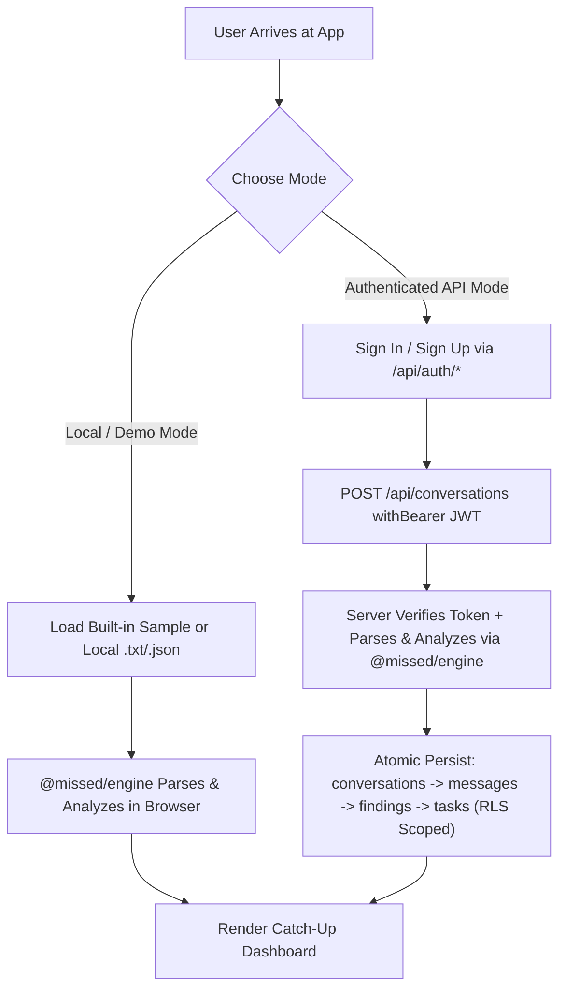
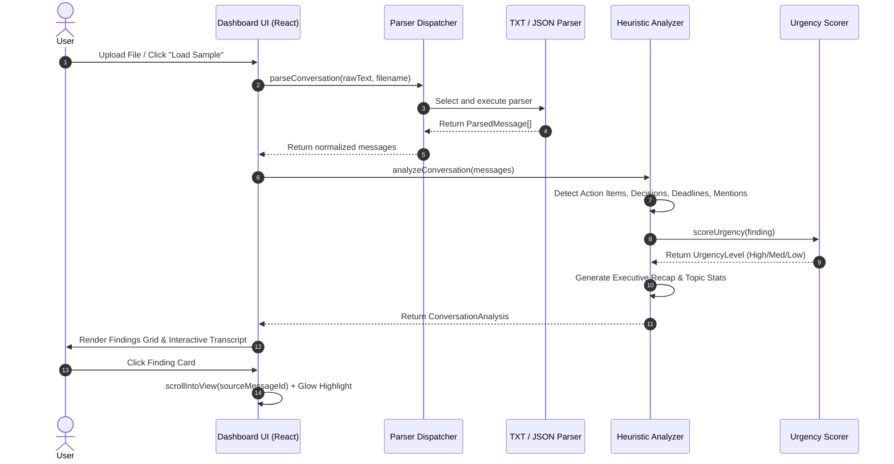

# ARCHITECTURE — What Did I Miss? (Missed.)

## 1. Project

**Project Name:** What Did I Miss? (Missed.)
**Repository:** `What-Did-I-Miss`
**Architecture Type:** npm Workspaces Monorepo (`packages/engine`, `frontend`, `server`, plus `extension/`)
**Execution Modes:**
1. **Local / Demo Mode (Client-Side):** 100% in-browser deterministic parsing and analysis with zero network calls.
2. **Authenticated Workspace Mode (`server/` + Supabase):** Opt-in authenticated persistence where conversations, messages, deterministic findings, tasks, and privacy settings are stored per-user under strict server-side bearer token verification and PostgreSQL Row-Level Security (RLS).

---

## 2. Problem

**The Challenge:** The Unread Problem — Information Overload in Team Chat Channels.  
Knowledge workers returning from absences or focused work face long streams of unread chat messages across Slack, Teams, WhatsApp, and Discord. Reading sequentially is slow, and critical information — such as blockers, decisions, deadlines, and assigned tasks — is easily overlooked.

**The Solution:**  
A privacy-first catch-up platform that imports exported chat files (`.txt` / `.json`) or loads an instant sample conversation, normalizes the messages via the shared `@missed/engine` package, and extracts prioritized insights:
- **Concise Executive Recap**
- **Action Items & Task Assignments**
- **Key Decisions**
- **Deadlines & Dates**
- **Urgent / Blocker Alerts**
- **Mentions & Addressed Questions**

Every insight is prioritized by urgency/relevance and deep-linked directly to the source message in the conversation timeline.

---

## 3. Users

1. **Busy Engineers & Leads:** Catching up on incident triage channels, deployment war rooms, or project planning threads after being offline.
2. **Product Managers & Scrum Masters:** Extracting decisions, blockers, and assigned action items without reading hundreds of chat messages.
3. **Privacy-Conscious Professionals:** Organizations and individuals who require deterministic local analysis by default and strict tenant isolation when saving conversation workspaces.
4. **Evaluators & Contributors:** Looking for an immediate, responsive demo (`Load Sample`) alongside a well-tested full-stack TypeScript codebase.

---

## 4. Core User Flow



---

## 5. Monorepo & Frontend Architecture

### 5.1. Tech Stack
- **Monorepo Workspaces:** npm workspaces (`packages/engine`, `frontend`, `server`)
- **Shared Analysis Engine (`@missed/engine`):** Pure TypeScript zero-dependency package containing parsers, deterministic heuristic detectors, recap generator, and built-in sample dataset
- **Frontend (`frontend/`):** React 19, Vite 8, TypeScript 5.8+, Tailwind CSS v4, Lucide React
- **Backend (`server/`):** Hono HTTP framework, `@hono/node-server`, Zod (strict runtime validation), `@supabase/supabase-js`
- **Database & Auth:** Supabase Auth (JWT) + Supabase PostgreSQL with Row-Level Security (RLS)
- **Browser Extension (`extension/`):** Chrome Manifest V3 side panel & WhatsApp Web content script built from `@missed/engine`

### 5.2. Repository Directory Structure
```text
What-Did-I-Miss/
├── packages/
│   └── engine/                  # Shared deterministic parsing & heuristic engine (@missed/engine)
│       ├── src/
│       │   ├── heuristics/      # analyzer.ts, detectors.ts, recapGenerator.ts
│       │   ├── parsers/         # index.ts, jsonParser.ts, txtParser.ts
│       │   ├── sampleConversation.ts
│       │   ├── types.ts
│       │   └── index.ts
│       └── tests/               # Engine unit tests
├── server/                      # Backend API & persistence workspace
│   ├── migrations/
│   │   └── 001_initial_schema.sql # PostgreSQL tables, indexes, triggers & RLS policies
│   ├── src/
│   │   ├── db/
│   │   │   ├── types.ts           # AuthAdapter & DataRepository contracts
│   │   │   ├── supabaseAdapter.ts # Supabase Auth + RLS-scoped PostgreSQL repository
│   │   │   └── testMemoryAdapter.ts # Isolated in-memory adapter for tests & offline dev
│   │   ├── lib/
│   │   │   ├── env.ts             # Validated environment parser & production guardrails
│   │   │   ├── errors.ts          # ApiError & centralized error serializer
│   │   │   └── requestBody.ts     # Byte-limited JSON body reader (10 MiB cap)
│   │   ├── middleware/
│   │   │   ├── auth.ts            # requireAuth Bearer token verification
│   │   │   ├── rateLimit.ts       # Sliding-window rate limiter
│   │   │   └── requestContext.ts  # X-Request-Id & security headers
│   │   ├── routes/
│   │   │   ├── authRoutes.ts      # /api/auth/*
│   │   │   ├── conversationRoutes.ts # /api/conversations/*
│   │   │   ├── taskRoutes.ts      # /api/tasks/:findingId
│   │   │   └── settingsRoutes.ts  # /api/settings
│   │   ├── schemas/
│   │   │   └── apiSchemas.ts      # Strict Zod request & response schemas
│   │   ├── app.ts                 # Hono application factory
│   │   └── index.ts               # Node HTTP server entrypoint
│   └── tests/
│       ├── api.test.ts            # 14 security, auth, validation & persistence tests
│       └── migrationSchema.test.ts# SQL schema & RLS verification tests
├── frontend/                    # React 19 + Vite 8 web application
└── extension/                   # Chrome Manifest V3 extension
```

---

## 6. Backend Architecture (`server/`)

- **Framework:** Built with **Hono** and **TypeScript (`strict: true`)**.
- **Authentication & Authorization (`requireAuth`):**
  - Extracts `Authorization: Bearer <token>` and verifies it server-side via `AuthAdapter.verifyToken()`.
  - Rejects missing, malformed, expired, or signed-out tokens with `401 UNAUTHORIZED`.
  - Never trusts `owner_id` or `user_id` from request bodies, query strings, or headers.
- **Validation & Abuse Protection:**
  - All request bodies, query parameters, URL UUIDs, and responses are validated with **Zod** (`.strict()` object schemas).
  - Pre-parse payload byte limit (`MAX_FILE_SIZE_BYTES = 10 MiB`) rejects oversized imports with `413 PAYLOAD_TOO_LARGE` before allocating large parse trees.
  - Sliding-window rate limiting protects `/api/auth/signup`, `/api/auth/signin`, and `POST /api/conversations` (`429 RATE_LIMITED`).
- **Storage Modes & Production Safety:**
  - `STORAGE_MODE=supabase` (default and strictly enforced when `NODE_ENV=production`) uses `SupabaseAuthAdapter` and `SupabaseDataRepository`.
  - `STORAGE_MODE=memory` uses `InMemoryAuthAdapter` and `InMemoryDataRepository` for deterministic automated tests and explicit offline local development. Startup fails immediately if `NODE_ENV=production` is combined with `STORAGE_MODE=memory` or missing Supabase credentials.

---

## 7. Database Design & Row-Level Security (`server/migrations/001_initial_schema.sql`)

### 7.1. Core Tables
1. **`public.conversations`**: Stores conversation metadata, source format, message/participant counts, `participants` (JSONB), `top_topics` (JSONB), `summary_bullets` (JSONB), and `owner_id` (`REFERENCES auth.users(id) ON DELETE CASCADE`). Defines `UNIQUE (id, owner_id)`.
2. **`public.messages`**: Stores normalized messages (`external_id`, `seq`, `sender`, `text`, `timestamp`, `conversation_id`, `owner_id`) with composite foreign key `(conversation_id, owner_id) REFERENCES public.conversations(id, owner_id) ON DELETE CASCADE`.
3. **`public.findings`**: Stores extracted findings (`type`, `title`, `snippet`, `priority`, `source_message_id`, `source_external_id`, `sender`, `timestamp`, `assignee`, `deadline`, `relevance_score`, `analyzer = 'deterministic' | 'ai'`, `owner_id`) with composite foreign key `(conversation_id, owner_id) REFERENCES public.conversations(id, owner_id) ON DELETE CASCADE`.
4. **`public.tasks`**: Stores task completion state (`finding_id UNIQUE`, `conversation_id`, `owner_id`, `completed`, `completed_at`) with composite foreign key `(finding_id, conversation_id, owner_id) REFERENCES public.findings(id, conversation_id, owner_id) ON DELETE CASCADE`.
5. **`public.user_settings`**: Stores per-user privacy and retention settings (`owner_id PRIMARY KEY`, `ai_enabled DEFAULT false`, `ai_consent_at`, `retention_days IN (7, 30, 90, 365)`).

### 7.2. Defense-in-Depth Row-Level Security (RLS)
- Every table executes both `ALTER TABLE ... ENABLE ROW LEVEL SECURITY` and `ALTER TABLE ... FORCE ROW LEVEL SECURITY`.
- Explicit `SELECT`, `INSERT`, `UPDATE`, and `DELETE` policies enforce `auth.uid() = owner_id` (plus parent conversation/finding ownership checks on `INSERT`).
- `SupabaseDataRepository` creates per-request clients scoped with the caller's Bearer JWT (`SUPABASE_ANON_KEY` + `Authorization: Bearer <token>`) so PostgreSQL RLS is active on every query, in addition to explicit `.eq('owner_id', ownerId)` filters.
- `SUPABASE_SERVICE_ROLE_KEY` is never used for routine CRUD queries; it is isolated strictly to `auth.admin.deleteUser(userId)` during verified account deletion (`DELETE /api/auth/account`).

---

## 8. APIs & Shared Engine Contracts

See [docs/API.md](./API.md) for full REST endpoint specifications and request/response schemas.

### 8.1. Shared Parser Contract (`@missed/engine`)
```typescript
export interface ParseResult {
  success: boolean;
  messages: ParsedMessage[];
  formatDetected?: 'json_standard' | 'json_slack' | 'txt_bracketed' | 'txt_whatsapp' | 'txt_simple';
  error?: string;
  warning?: string;
}

export function parseConversation(content: string, fileName?: string): ParseResult;
```

### 8.2. Shared Heuristic Analysis Contract (`@missed/engine`)
```typescript
export function analyzeConversation(messages: ParsedMessage[]): ConversationAnalysis;
```


---

## 10. Data Flow & Processing Pipeline



---

## 11. Deployment Plan

- **Target Architecture:** Static Web Application (Single-Page Application).
- **Build Output:** Static HTML, JavaScript, and CSS bundle via `vite build` into `frontend/dist/`.
- **Hosting Options:**
  - Local browser preview via `npm run preview`.
  - Static hosting on GitHub Pages, Vercel, Netlify, or Cloudflare Pages.
- **Environment Variables:** None required for MVP.

---

## 12. Important Technical Decisions

### Decision 1: Transparent Rule-Based Heuristics over Remote Generative AI
- **Context:** The challenge is summarizing chat messages on a strict hackathon timeline without privacy breaches.
- **Decision:** Build a deterministic rule-based NLP extraction engine using curated regular expressions, linguistic cues, and lexical keyword weights.
- **Tradeoff & Mitigation:**
  - *Pros:* 100% private, 0ms network latency, $0 cost, zero API key requirements, 100% deterministic, transparent, and debuggable.
  - *Tradeoff:* Cannot perform open-ended abstractive synthesis like an LLM.
  - *Mitigation:* Explicitly label the feature as "Deterministic Heuristic Analysis" in the UI. Deliver superior structure: categorized findings, urgency scoring, and exact source message jump links.

### Decision 2: 100% Client-Side In-Browser Execution
- **Context:** Deciding between a Python/FastAPI backend vs. purely in-browser React.
- **Decision:** Run all parsing and analysis directly in the browser via JavaScript.
- **Rationale:** Meets the strict privacy requirement ("Keep conversation contents and summaries on-device. Do not upload them to a backend or remote AI API"). Simplifies deployment to a single static bundle.

### Decision 3: Standard Internal Message Representation (`ParsedMessage`)
- **Context:** Chat exports come in diverse shapes (Slack JSON, WhatsApp text, bracketed timestamps, raw logs).
- **Decision:** Isolate all formatting variations at the ingestion boundary and normalize everything into `ParsedMessage`.
- **Rationale:** All downstream heuristic extractors, search filters, and UI renderers depend solely on the normalized schema, making new format additions straightforward.

### Decision 4: Source Message Deep Linking via DOM Refs
- **Context:** Users need immediate context verification for any extracted finding.
- **Decision:** Every `FindingItem` retains `sourceMessageId`. Clicking a card triggers smooth DOM scrolling to the corresponding message in the transcript with a temporary CSS highlight ring.
- **Rationale:** Builds trust by showing users the exact source behind every extracted insight.

### Decision 5: Zero Added Dependencies Policy
- **Context:** Existing frontend has `react`, `react-dom`, `lucide-react`, `tailwindcss`, `recharts`, `react-router-dom`.
- **Decision:** Do not install additional npm packages. Use existing libraries and native browser APIs (e.g., native `FileReader`, `crypto.randomUUID()`, `navigator.clipboard`).

---

## 13. Privacy Boundaries & Security Model

```text
+--------------------------------------------------------------------------+
| USER'S BROWSER SANDBOX                                                   |
|                                                                          |
|   +-----------------------+       +----------------------------------+   |
|   | Local File / Sample   | ----> | FileReader (In-Memory ArrayBuffer)|   |
|   +-----------------------+       +----------------------------------+   |
|                                                     |                    |
|                                                     v                    |
|                                   +----------------------------------+   |
|                                   | Parsers & Normalization Engine   |   |
|                                   +----------------------------------+   |
|                                                     |                    |
|                                                     v                    |
|                                   +----------------------------------+   |
|                                   | Heuristic Extraction & Scoring   |   |
|                                   +----------------------------------+   |
|                                                     |                    |
|                                                     v                    |
|                                   +----------------------------------+   |
|                                   | React State & DOM Rendering      |   |
|                                   +----------------------------------+   |
+--------------------------------------------------------------------------+
                     ||  (NO OUTBOUND NETWORK REQUESTS)
                     \/
             [ EXTERNAL INTERNET ] (Completely isolated)
```

- **Data Confinement:** User data never leaves the JavaScript virtual machine heap.
- **Network Isolation:** No network requests are made for message processing or analysis.
- **Export Safety:** "Copy Summary" utilizes the browser's local `navigator.clipboard.writeText()` API.

---

## 14. Error Handling & Edge Case Strategy

1. **Empty Files:** Checks file length before reading; displays non-blocking warning without crashing.
2. **Invalid / Broken JSON:** Trapped via `try { JSON.parse() } catch { ... }` with guidance to check syntax or use text format.
3. **Missing Timestamps:** Parser assigns sequential order indices; UI displays a neutral "Time not specified" indicator.
4. **Unformatted Text:** Fallback parser groups non-empty lines into sequential messages with generic sender labels.
5. **Multi-line Messages:** TXT parser checks for header regex; non-matching lines append to the preceding message body.

---

## 15. Implementation Plan (3h 45m Competition Timeline)

- **Phase 1 (0:00 – 0:30): Architecture, Types & Sample Dataset**
  - Finalize TypeScript types in `types/`.
  - Implement realistic incident catch-up conversation dataset (`data/sampleConversation.ts`).
- **Phase 2 (0:30 – 1:15): Resilient Ingestion & Parsers**
  - Build `txtParser.ts` (Bracketed, WhatsApp, Simple colon).
  - Build `jsonParser.ts` (Array, Object with messages, Slack export).
  - Build `parsers/index.ts` dispatcher with format auto-detection.
- **Phase 3 (1:15 – 2:00): Heuristic Extraction & Prioritization**
  - Implement pattern matchers for Action Items, Decisions, Deadlines, Urgency, Mentions.
  - Implement multi-factor urgency scoring (`high`, `medium`, `low`).
  - Implement executive recap generator.
- **Phase 4 (2:00 – 2:45): Interactive Dashboard & Deep Linking**
  - Implement Dropzone with "Load Sample" button.
  - Implement Recap cards and Categorized Findings grid.
  - Implement Transcript Viewer with scroll-to-element and pulse highlight.
- **Phase 5 (2:45 – 3:15): Search, Filters & Export (P1 Features)**
  - Implement real-time text search across findings and messages.
  - Implement Category tabs, Participant filter, and "Filter for me".
  - Implement "Copy Summary to Clipboard".
- **Phase 6 (3:15 – 3:45): Verification, Error Handling & Final Polish**
  - Test all edge cases (empty file, malformed JSON, missing timestamps).
  - Polish layout, typography, colors, and badge contrast.
  - End-to-end demo dry run.